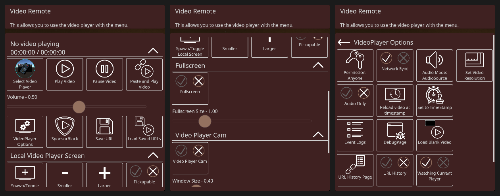

<p align="center">
  
</p>

# Video Remote Mod

This is a **MelonLoader** Mod for **ChilloutVR**, 
The **Video Remote mod** adds QOL changes to **ChilloutVR** being able to have an easier time to do certain functions while in VR & Desktop.

**ChilloutVR website**: https://abinteractive.net

**Steam Store Page**: https://store.steampowered.com/app/661130/ChilloutVR/

This modification is unofficial and not supported by ChilloutVR or the ChilloutVR team. Using this modification might cause issues with performance, security or stability of the game.

This mod is not affiliated, approved, or verified by the ChilloutVR team in any way whatsoever.

Parts of this mod's code that patch or reference the game may be owned by the ChilloutVR team.

**MelonLoader**: https://melonwiki.xyz/#/?id=requirements


# Discord
ChilloutVR Modding Group: https://discord.gg/dndGPM3bxu

# Mod Information

This mod allows you to have Video Remote Controls in the Quick Menu.

This is the feature request for this mod. https://feedback.abinteractive.net/p/video-player-remote-control

# Features

- Pick a video player in the current world, closest first (auto-selects when only one exists)
- Play / Pause / Paste-and-Play, with volume slider
- Spawn a local copy of the video screen with size and pickup controls
- Permission (lock level), Network Sync, Audio Mode and Max Resolution controls
- Watching toggle and Play untrusted URL for the selected player
- Fullscreen: show the video head-locked in your view (local only)
- Video Player Cam: a small movable head-locked video window (local only)
- Audio-only (YouTube) toggle
- Reload current video at the same timestamp
- Manual timestamp seek (hour / minute / second inputs and ±1 / ±5 min jog buttons)
- Auto-generated chapter-style timestamp jumps
- Event log and Debug page (FPS, codec, resolution, audio channels...)
- Save URLs and replay them later, with a per-session URL history and Copy URL to Clipboard
- SponsorBlock: automatically skip sponsor / self-promo / interaction / intro segments
- Load Blank Video preset
- Optional icon tint that follows your menu accent color
- Subtitles: pick the video's captions or subtitles track from a dropdown (only changes it for you)
- Translatable menus: follows the game's language, or pick one in VideoPlayer Options > Language

# Translations

The mod's menus can be translated with a language file. English is the only language included, and `Languages/en.json` is the example of the format:

```json
{
  "code": "en",
  "name": "English",
  "strings": {
    "Play Video": "Play Video",
    "Subtitles: {0}": "Subtitles: {0}"
  }
}
```

To add a language:

1. Start the game once with the mod. It writes `ChilloutVR/UserData/VideoRemote/Languages/_template.json` with every menu string.
2. Copy it to a new file in the same folder, for example `fr.json`.
3. Set `code` to the game's language code (for example `fr`) and `name` to the language's name.
4. Replace the text on the right of each line with the translation. Keep `{0}`, `{1}` and `<p>` as they are.
5. Restart the game. Pick the language in VideoPlayer Options > Language, or leave it on Auto to follow the game's language.

Any line you leave out stays in English.

# Credits

- **DjShinter (Shin)**: original author. https://github.com/DjShinter
- **Nirvash**: SponsorBlock, URL history, timestamp controls, debug page, audio-only mode and resolution selector. https://github.com/Nirv-git

Both are also listed on the Contributors page in the mod.

# Installation

This mod **no longer requires BTKUILib**. It uses the UI library built into ChilloutVR, which is based on BTKUILib and is now developed as part of the game by the original BTKUILib author.

To install the "**Video Remote Mod**" place "**VideoRemote.dll**" inside your "Mods" folder located in **ChilloutVR** > **Mods**.

# Building this project

I'm not going to provide "**MelonLoader.dll**" & game files related to ChilloutVR, this is on you!

Built for ChilloutVR on Unity 6 (6000.3) with MelonLoader 0.7.3.

The `Libs/` folder needs the current versions of these DLLs (copy from your game install):

| File | Source |
| --- | --- |
| `MelonLoader.dll`, `0Harmony.dll` | `ChilloutVR/MelonLoader/net35/` |
| `Assembly-CSharp.dll`, `GameCommon.dll`, `Newtonsoft.Json.dll`, `Unity.TextMeshPro.dll` | `ChilloutVR/ChilloutVR_Data/Managed/` |
| `UnityEngine.dll`, `UnityEngine.CoreModule.dll`, `UnityEngine.IMGUIModule.dll`, `UnityEngine.ImageConversionModule.dll`, `UnityEngine.InputLegacyModule.dll`, `UnityEngine.InputModule.dll`, `UnityEngine.PhysicsModule.dll`, `UnityEngine.UnityWebRequestModule.dll` | `ChilloutVR/ChilloutVR_Data/Managed/` |

The stock game DLLs are enough, no publicized Assembly-CSharp is needed.

Then open `VideoRemote.sln` and build, or run `dotnet build -c Release`.

# Developer Note

If this mod breaks the terms of service, I will shut down this project as soon as I am told about it. I believe it is a quality of life change.

# Is this mod allowed?

The ChilloutVR team allows mods as long as they follow section 6 of the Terms of Service. This mod is written to follow those rules as closely as it can.

**The ChilloutVR team can still take action against accounts that use mods**, so if you are worried about that, **do not install mods**.

Terms of Service, section 6 "Modding Our Game": https://docs.chilloutvr.net/official/legal/tos/#6-modding-our-game

Source of the terms on GitHub: https://github.com/ChilloutVR-Team/docs/blob/develop/docs/official/legal/tos.md

§6.1 Mods knowingly degrading the experience for other players as well as those intentionally replacing or removing core features of the base game are not permitted. ✅ This mod only adds controls for the game's own video players and does not remove anything.

§6.2 When overriding parts of the game's code, you must include a disclaimer in the released source code or description of your mod indicating that parts of the modification's code may be/are owned by the ChilloutVR team if applicable. ✅ See the disclaimer at the top of this page.

§6.3 When releasing mods to the public, regardless if released with or without publicly available source code, it is mandatory to state that the modification is not affiliated, approved, or verified by the ChilloutVR team in any way whatsoever. ✅ See the disclaimer at the top of this page.

§6.4 You may never use or create a modification with the purpose of bypassing limitations of worlds, instances, or game modes currently used. This includes, but is not limited to, bypassing game rules like flight and props. ✅ The mod goes through the game's own video player functions and permission settings, and does not bypass world or instance rules.

§6.4.1 You may never use or create modifications with the intent or functionality to cheat in game worlds or game modes. ✅

§6.5 By installing a mod loader and/or corresponding modifications or plugins, you acknowledge that the ChilloutVR team is not responsible for any harm or damage caused by the modifications or the mod loader installed by the user. ✅

The source code of this mod is public, and it is not obfuscated.
